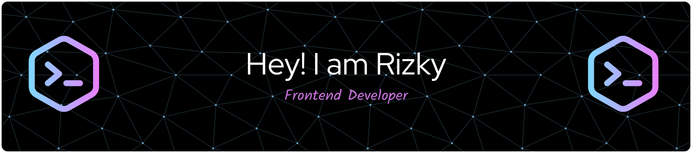

# 💫 About Me:
Hi, I'm Rizky! I'm a Junior Frontend Developer. I design UI/UX interfaces using Penpot, build modern responsive web apps with React and Tailwind CSS, and am currently expanding my skills into backend development with Node.js.

## 🌐 Socials:
 

## 💻 Tech Stack:
      
